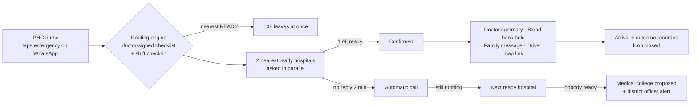
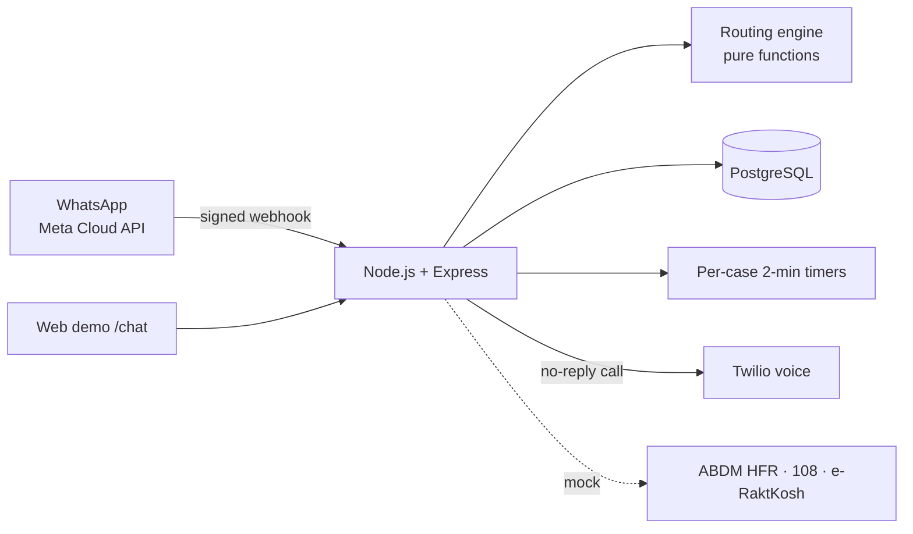

# Matri-Kavach

**Every referred mother reaches a hospital that has said it is ready.**

Matri-Kavach is a WhatsApp-first referral routing service for maternal emergencies in rural India. A PHC nurse taps the emergency, and the system does the rest. It picks the nearest hospital that is ready **tonight**, sends 108 at once, and gets the hospital to confirm while the mother is on the way. If nobody answers, it escalates automatically. It also gets the doctor, the blood bank and the family ready before she arrives.

Built for **Health-a-thon 2026** by **Team InnoVerse** (code I44UEW).

| | |
|---|---|
| **Live MVP** | https://matri-kavach-mvp.onrender.com (no login) |
| **WhatsApp-style demo** | https://matri-kavach-mvp.onrender.com/chat |
| **Real WhatsApp** | Live on Meta WhatsApp Cloud API (test number) |
| **Tests** | 78 automated tests, `npm test` |
| **Data** | Synthetic only. No real patient, hospital or family. |

> The free server sleeps when idle, so the first load can take up to a minute.

---

## The problem: referral ping-pong

In an emergency such as heavy bleeding after delivery (PPH), the mother is taken to the **nearest** facility, not the nearest **ready** one. If that facility has no anaesthetist, no free theatre or no blood tonight, she is referred again. Every extra move costs time she does not have.

- A review of 1,000+ maternal deaths found that women had passed through **about three facilities**, and **about a third died in transit**.
- India's MMR is **87 per lakh live births** (SRS 2022-24). PPH is the leading direct cause.
- 108 moves the mother fast. But nobody checks whether the hospital is ready tonight, and nobody tells it she is coming. These are delays 2 and 3 of the *three delays* model.

## What Matri-Kavach does



1. **Readiness routing.** The engine picks the nearest hospital on the district's referral list whose doctor-signed checklist is all *yes* this shift. A hospital that has not checked in is **Uncertain**, never treated as Ready.
2. **Confirm en route.** The ambulance never waits for a confirmation. The two nearest ready hospitals are asked together. The nearer one has priority, and the other is the backup.
3. **Automatic escalation.** If there is no reply in 2 minutes, the system calls the duty phone. If there is still no answer, it moves to the next ready hospital. If no hospital is ready, the medical college is proposed and the district officer is alerted.
4. **Ready before arrival.** The doctor gets a facts-only summary through a link that expires in 2 hours. The blood bank is asked to hold a unit of her group, and the family gets a short message.
5. **Closed loop.** The system records arrival, asks "was it really ready?", and records discharge with a back-referral to the PHC and ASHA. The district dashboard shows readiness gaps by facility and shift.

## Right message, right phone (role-based messaging)

Every message is written for **one role**. The server looks up the phone number, finds the role and the facility or ambulance, and sends only that role's message. A reply is matched to the case through the sender's number.

| Role | Gets on WhatsApp | Number comes from (real deployment) |
|---|---|---|
| PHC nurse | Language choice, emergency list, patient form, proposal, SEND / CHANGE, status | PHC duty phone, OTP login |
| Labour room (DH / SDH / CHC) | `INCOMING` with ETA and facts, buttons 1 / 2 / 3, TEAM, DISCHARGED | Duty phone registered once with the HFR facility list |
| 108 driver | Pickup point, hospital, Google Maps route. **Never patient details** | 108 control room |
| 108 EMT | Clinical handover (ISBAR) and a `WORSE` button | 108 control room |
| Doctor on call | Facts-only summary link (expires in 2 h) | District duty roster |
| Blood bank | Hold request for the mother's blood group (JSSK) | District blood bank list |
| Family | Hospital name, ETA, "bring the MCP card" | Typed by the nurse for this case only |
| District officer | Escalations, missed check-ins and gaps. No patient name | District |

The district registers the numbers once. Nothing is set up per case. In the demo, numbers are added by hand only because Meta's free test number allows 5 recipients.

## Try it in 2 minutes

Open **https://matri-kavach-mvp.onrender.com/chat**. Each visitor gets a private session that sends nothing to real phones.

1. On the **Nurse** phone, tap **Hi**, choose **English**, then **Choose emergency → Heavy bleeding**.
2. Tap **Fill patient details → Send**. The values are pre-filled.
3. See the proposal. CHC Sonpur is skipped because it has no anaesthetist tonight, and DH Devgarh is proposed with the time of its last readiness check. Tap **SEND**.
4. Use **Switch phone** to open **DH Devgarh** and tap **1 All ready**, or **3 Not available** to watch the reroute to SDH Kheri.
5. Open the **Doctor**, **Blood bank**, **Family**, **108 driver** and **108 EMT** phones to see what each person gets.

Other things to try from the ⋮ menu:
- **Skip 2 minutes** (automatic call, then reroute)
- **No hospital ready**
- **Two at once** (two mothers, two ambulances)
- **Auto-play**
- **District settings** (Hindi, reply time, HFR linkage)
- **Emergency checklists**

## Live on real WhatsApp

The same engine runs on real WhatsApp through the **Meta WhatsApp Cloud API**:

- reply buttons and list messages (language, emergency, SEND / CHANGE, 1 / 2 / 3);
- an **in-chat patient form** built with WhatsApp Flows, with a one-page web form as fallback;
- English and Hindi (the Hindi texts are pending clinical review);
- `HELP`, `STATUS`, `RESET`, `NEW`, `CASE B`, `WORSE`, `TEAM`, `DISCHARGED`;
- quick keywords like `BLEED B+` or `FITS O+`, which work like an SMS.

The full flow was tested end to end on real phones, with the nurse and the receiving hospital on separate phones.

## Emergencies covered

Six readiness checklists, all **signed by our clinical partner, Moulvi Gufran** (final-year MBBS), on 7 Nov 2026:

- heavy bleeding after delivery (PPH);
- fits / eclampsia;
- obstructed labour;
- bleeding before delivery (APH);
- fever after delivery (sepsis);
- newborn emergency.

All six come from one 17-item shift check-in, grouped as Staff, Rooms and beds, Blood and drugs, Equipment and lab. For PPH, a hospital needs all of these: blood for the mother's group, an obstetrician, an anaesthetist, a free theatre, uterotonics, IV fluids and an HDU bed. **Other** is never routed. The nurse is told to call the doctor. An obstetrician and a paediatrician must still validate the lists before any pilot.

## Architecture



- **Routing engine** (`src/engine.js`): pure, deterministic functions. The same input gives the same route, 100 times out of 100. No AI in routing, on purpose, so that doctors can audit every decision.
- **Server** (`server/`): Express app, case sessions, timers, Meta WhatsApp, WhatsApp Flows, Twilio voice and SMS, and a Postgres store (it falls back to memory when `DATABASE_URL` is not set).
- **Frontend** (`index.html`, `chat.html`, `src/`): plain HTML and JS with no build step. A dashboard view and a WhatsApp-style view share the same `/api/act` actions.
- **Simulation** (`sim/`): a Python model with 20,000 night emergencies, plus a run of the real JS engine.

### Where AI is used, and where it is not

| Used | Not used, on purpose |
|---|---|
| Next step: turning the in-charge's shift voice note into checklist answers, always shown back for confirmation | Picking the hospital, deciding readiness, diagnosis, risk scores |

## Safety and privacy

- **Assistive, never diagnostic.** The nurse chooses the emergency, doctors define readiness, and the system only routes and informs.
- Only doctor-signed checklists are switched on. **Uncertain is never treated as Ready.** The medical college is never skipped.
- Facts-only summary, with no risk score.
- **Minimum data per role.** The driver, family and district never get clinical details. The summary link expires in 2 hours.
- Messages go only to registered numbers. Webhooks are signature-checked, and keys are kept only in server settings.
- Every decision is logged, and the nurse can override with **CHANGE**.

## Evaluation

| What | Result |
|---|---|
| Automated tests | **78 passing**: confirm, silence, call, reroute, nobody ready, Uncertain never Ready, determinism, forged webhooks, two mothers at once, in-chat form |
| Real phones | Full referral on real WhatsApp with separate nurse and hospital phones |
| Simulation, 20,000 night emergencies (synthetic district) | Ready hospital at the first facility: **52% → 97%**. Average time to a ready hospital: **131 → 63 min** |
| Real engine on simulated nights (85% check-ins) | First hospital reached was ready in **99.6%** of cases. Mean time to a ready hospital: 129 → 66 min |

> The simulations model the routing rules on synthetic data. They are not field results. A 10-week district pilot is the next validation step.

## Run it locally

```bash
git clone https://github.com/MG782469/matri-kavach-mvp.git
cd matri-kavach-mvp
npm install
npm start          # http://localhost:3000  and  /chat
npm test           # 78 tests
```

Node 20 or newer. With no environment variables set, the app runs fully in memory, as a demo that sends no messages.

### Environment variables (all optional)

| Variable | Purpose |
|---|---|
| `DATABASE_URL` | PostgreSQL connection string. Without it, state is kept in memory |
| `LIVE_KEY` | Unlocks the real-phone session (`/?key=...`). Judges' sessions never message real phones |
| `WA_TOKEN`, `WA_PHONE_NUMBER_ID`, `WA_GRAPH_VERSION` | Meta WhatsApp Cloud API |
| `WA_WABA_ID`, `WA_FLOWS`, `WA_FLOW_MODE`, `WA_DISPLAY_NUMBER` | WhatsApp Flows (in-chat form) settings |
| `TEST_PHONE` | Default demo phone for every role |
| `PHONE_<ROLE>` | Phone number for one role: `NURSE`, `DH`, `SDH`, `CHC`, `MC`, `DOCTOR`, `BLOODBANK`, `FAMILY`, `DISTRICT`, `ASHA`, `DRIVER`, `EMT`, `DRIVER2`, `EMT2`. Unset roles fall back to `TEST_PHONE` |
| `TWILIO_ACCOUNT_SID`, `TWILIO_AUTH_TOKEN`, `TWILIO_SMS_FROM` | No-reply voice call and SMS fallback |
| `REPLY_WINDOW_SEC`, `IVR_WAIT_SEC`, `BLOOD_HOLD_MIN` | Timers |
| `PUBLIC_BASE_URL` | Public URL for links (Render sets `RENDER_EXTERNAL_URL` automatically) |

`render.yaml` is a Render Blueprint for one-click deploys.

## Project structure

```
server/   index.js (routes, webhooks) · session.js (cases, timers, actions) · meta.js (WhatsApp)
          flows.js (WhatsApp Flows form) · notify.js (Twilio) · store.js (Postgres)
src/      engine.js (routing rules) · data.js (synthetic district, checklists) · messages.js (EN/HI texts)
          app.js (dashboard) · chat.js (WhatsApp-style view)
tests/    engine, server, features, multicase, emt, flows
sim/      20,000-case simulation (Python) and real-engine simulation (JS)
```

## Roadmap

- **Pilot:** one district for 10 weeks, with the district maternal health officer. Success means more referrals closed with an outcome, more first hospitals that were ready, fewer minutes to a ready hospital, and a high check-in rate.
- **Clinical:** obstetrician and paediatrician validation of the six checklists, then planned (non-emergency) referrals.
- **Product:** voice-note AI for the shift check-in, live 108 GPS ETA, bed and blood counts per hospital, Telugu.
- **Integrations:** ABDM HFR, 108 dispatch (destination only), e-RaktKosh, and a verified WhatsApp Business number.

## Team InnoVerse

- **Manas Girdhar**, Team Leader and Technical Lead (B.Tech, BIT Mesra). Built the routing engine, the server, the WhatsApp integration and the simulation.
- **Moulvi Gufran**, Clinical partner (final-year MBBS, Government Medical College, Vizianagaram). Wrote and signed the readiness checklists and reviewed every staff message.

---
Maintained by Manas Girdhar (MG782469)
*Prototype for Health-a-thon 2026. All names, hospitals, phone numbers and cases are synthetic. Not a medical device. It does not diagnose or replace clinical judgement.*
